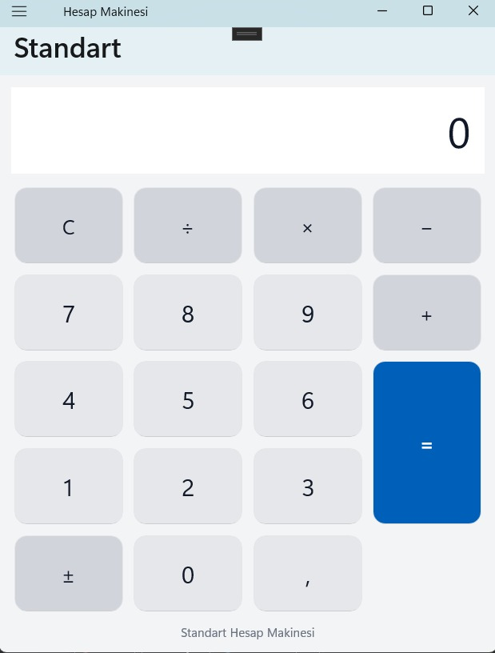
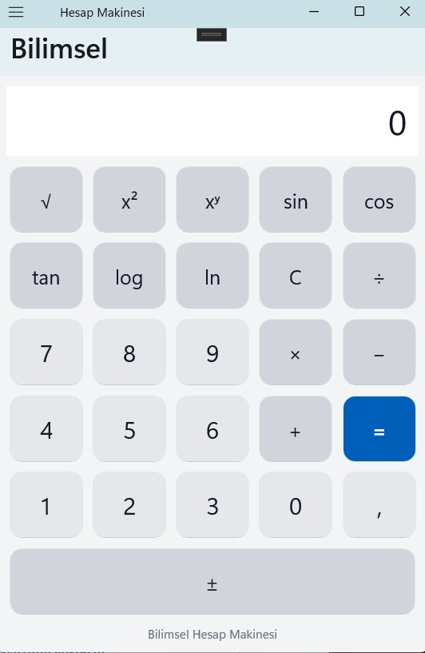
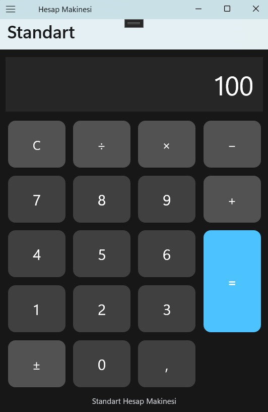

#  .NET MAUI Hesap Makinesi

Bu proje, **.NET MAUI** kullanılarak C# ve XAML ile geliştirilmiş bir hesap makinesi uygulamasıdır. Uygulama, standart ve bilimsel hesaplama işlemlerini desteklemekte ve kullanıcıya açık/koyu tema seçeneği sunmaktadır.

##  Özellikler

### 1. Standart Hesap Makinesi
- Toplama (+)
- Çıkarma (-)
- Çarpma (×)
- Bölme (÷)
- Ondalıklı sayı işlemleri
- Sayının işaretini değiştirme (+/-)
- Ekranı temizleme (C)

### 2. Bilimsel Hesap Makinesi
- Karekök (√)
- Sayının karesini alma (x²)
- Üs alma (xʸ)
- Sinüs (sin)
- Kosinüs (cos)
- Tanjant (tan)
- 10 tabanında logaritma (log)
- Doğal logaritma (ln)

Trigonometrik işlemler derece cinsinden gerçekleştirilmektedir.

### 3. Tema Ayarları
- Açık tema
- Koyu tema
- Sistem temasını kullanma
- Tema değişikliklerinin anında uygulanması
- Seçilen temanın Preferences kullanılarak kaydedilmesi
- Uygulama yeniden açıldığında önceki temanın korunması

### 4. Hata Yönetimi
- Sıfıra bölme kontrolü
- Negatif sayıların karekökünü alma kontrolü
- Geçersiz logaritma işlemlerinin kontrolü
- Tanımsız trigonometrik işlemlerin kontrolü
- Geçersiz ve sonsuz sonuçların kontrolü

##  Kullanılan Teknolojiler

- **C#** – Hesaplama işlemleri ve uygulama mantığı
- **.NET MAUI** – Çok platformlu uygulama geliştirme
- **XAML** – Kullanıcı arayüzü tasarımı
- **Shell** – Sayfalar arası gezinme
- **ResourceDictionary** – Renk ve stil kaynaklarının yönetimi
- **Preferences** – Tema tercihinin cihazda saklanması
- **Math Sınıfı** – Matematiksel işlemlerin gerçekleştirilmesi

##  Proje Yapısı

```text
HesapMakinesi/
│
├── App.xaml
├── App.xaml.cs
│
├── AppShell.xaml
├── AppShell.xaml.cs
│
├── Colors.xaml
├── Styles.xaml
│
├── MainPage.xaml
├── MainPage.xaml.cs
│
├── ScientificPage.xaml
├── ScientificPage.xaml.cs
│
├── SettingsPage.xaml
└── SettingsPage.xaml.cs
```

##  Tasarım ve Stil Yönetimi

Uygulamada renkler ve stiller ayrı kaynak sözlüklerinde tutulmaktadır.

- **Colors.xaml:** Açık ve koyu tema renklerini içerir.
- **Styles.xaml:** Ortak buton, rakam butonu, işlem butonu, eşittir butonu ve yazı stillerini içerir.

Stil yönetiminde örtük stiller, açık stiller ve `BasedOn` özelliği kullanılmıştır. Böylece tekrar eden tasarım kodları azaltılmıştır.

##  Sayfa Geçişleri

Sayfalar arası geçiş .NET MAUI Shell kullanılarak gerçekleştirilmiştir.

Uygulamada üç ana sayfa bulunmaktadır:

1. Standart Hesap Makinesi
2. Bilimsel Hesap Makinesi
3. Ayarlar


##  Uygulamadan Görüntüler

### Standart Hesap Makinesi


### Bilimsel Hesap Makinesi


### Ayarlar



